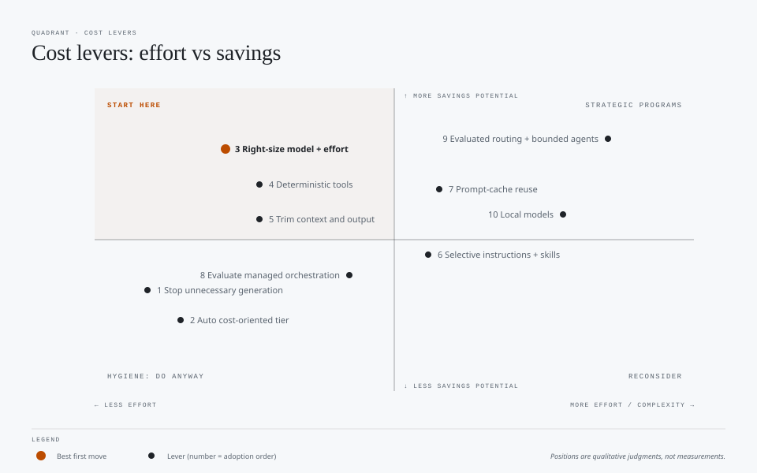

# gh-model-demos

This repository contains fact-checked guidance, examples, and a test harness for **reducing AI model and token cost** in GitHub Copilot and in agent workloads, without lowering quality.

The metric throughout is **cost per accepted completion**, not cost per call.

## What's here

| Folder | Contents |
|---|---|
| [`docs/`](docs/README.md) | Fact-checked guides on cost levers, workloads, prompt caching, harnesses and effort settings, model routing, and frontmatter design, plus concept diagrams |
| [`prompts/`](prompts/README.md) | A good and a bad prompt for each of 16 patterns (one-shot, multi-turn, RAG, agent loop, orchestration, …), with expected processing and results |
| [`agent-assets/`](agent-assets/README.md) | Good and bad skills, agents, instructions, prompt files, and progressive-disclosure examples |
| [`tests/`](tests/README.md) | A Docker-based Copilot CLI harness that runs the good and bad variants side by side and reports on cost, quality, and reliability |
| [`.github/`](.github/copilot-instructions.md) | Copilot instructions for working in this repository |

## Start here

1. Read the [docs index](docs/README.md) for the reading order and a concept index.
2. Begin with [Lower token cost per completed workflow](docs/model-usage-cost-optimization.md), which ranks the levers from easiest to most complex.
3. Compare patterns side by side in [`prompts/`](prompts/README.md) and [`agent-assets/`](agent-assets/README.md).
4. Measure them yourself with the [test harness](tests/README.md).

## Key concepts

- **Workload shape outweighs per-call price.** In Anthropic's production data, agents used about 4 times the tokens of chat interactions, and multi-agent systems about 15 times. See [AI workloads and cost](docs/ai-workloads-cost.md).
- **Caching rewards a stable prefix.** Put stable context first and volatile context last. See [Prompt caching](docs/prompt-caching-guidance.md).
- **"Routing" means five different things.** Only post-answer escalation sees the answer before deciding. See [Model selection and execution shapes](docs/model-selection-and-execution-shapes.md).
- **Effort is not thinking, and neither is verbosity.** See [Harnesses and effort](docs/harnesses-and-effort.md).
- **Progressive disclosure keeps context small.** Assets pay only for what they load. See [Frontmatter and scripts](docs/frontmatter-and-scripts.md).

## Caveats

- Product names, prices, and preview features reflect the sources cited in each doc, as of October 2026. Check them again before presenting.
- In `prompts/` and `agent-assets/`, "good" and "bad" are labels for the experiment, not proven outcomes. The harness tests them.
