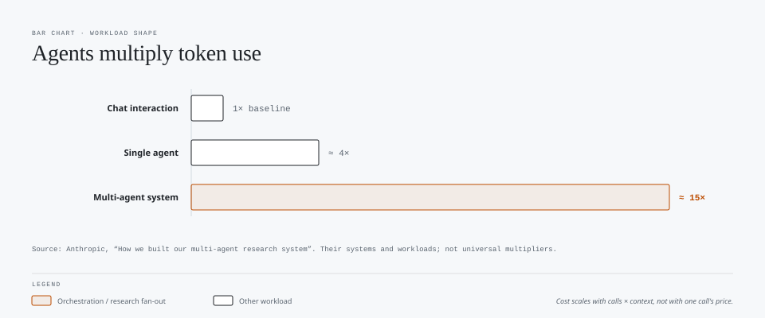
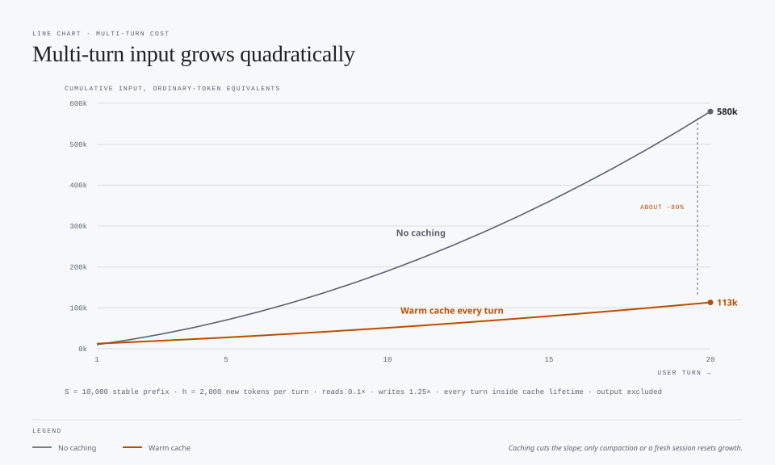

# AI Workloads and Cost: How Workload Shape Changes Spend

Prepared October 15, 2026. All calculations are illustrative unless a source is cited. Prices, product features, and model behavior can change.

## Main conclusion

**Workload shape affects cost more than the price of an individual call.** Every workload is built from the same unit: one model call that reads input tokens and generates output tokens. Workloads differ in three things:

- How many calls they make.
- How the context of each call grows.
- Whether anything stops the calls.

| Workload | Calls | How input grows | Natural stopping point |
|---|---|---|---|
| Single task (one shot) | About 1 | Constant | The answer |
| Multi-turn | 1 or more per user turn | Accumulates with conversation history | The user stops |
| Research (debate, ensemble, fan-out) | Agents x rounds | Multiplies across agents; debate adds peer outputs | Only if designed in |
| Agentic (headless) | One per step; steps are open-ended | Accumulates with tool results | Only if designed in, with no human present |
| Orchestration | Orchestrator plus all workers | Split across isolated contexts, plus coordination | Only if designed in |

Moving down the table, cost depends less on prompt quality and more on **stopping rules, context management, and delegation design**. The metric remains **cost per accepted completion**, not cost per call.

Anthropic's production data gives a useful order of magnitude: agents used about **4 times** more tokens than chat interactions, and multi-agent systems about **15 times** more. [1] These figures come from Anthropic's systems and workloads; they are not universal multipliers.


## 1. Shared cost model

```text
Workload cost = sum over every model call (main agent, subagents, judges, retries):
    ordinary input x input rate
  + cache writes x write rate        (where charged separately)
  + cache reads  x read rate         (typically far cheaper than ordinary input)
  + output, including billed reasoning, x output rate
```

Variables used below:

| Symbol | Meaning |
|---|---|
| `S` | Stable prefix: system instructions, tool definitions, repository guidance |
| `h` | Tokens added to the context per turn or step: messages, tool results |
| `n` | User turns |
| `s` | Agent steps (model calls in a tool loop) |
| `k` | Parallel agents or samples |
| `r` | Debate or review rounds |
| `a` | Average tokens in one agent's response |

Do not sum provider usage fields blindly. Cached tokens may be reported inside input totals, and reasoning may be reported inside output totals. See the [prompt caching guide](prompt-caching-guidance.md).

## 2. Comparison

| | Single task | Multi-turn | Research | Agentic (headless) | Orchestration |
|---|---|---|---|---|---|
| **Cost scaling** | About `S + input + output` | Grows faster than linearly with turns if history is replayed | At least proportional to `k x r`; can reach about `k^2 x r^2` input | Grows faster than linearly with steps as tool results accumulate | Sum of workers plus orchestrator plus coordination overhead |
| **Dominant cost** | Input size, or output for generation tasks | Replayed history | Parallel calls and reading peer outputs | Tool results replayed in later steps | Duplicated briefing context and synthesis |
| **Caching benefit** | Low for a single call; high for repeated batches with a stable prefix | High while turns stay within the cache lifetime | Moderate; agents with different contexts do not share prefixes | High within a run; lower across runs separated in time | Workers with identical prefixes may share cache; measure it |
| **Typical failure** | Over-generation, unnecessary tools | Late requirements, rework, context drift | Unbounded rounds, correlated errors, no convergence | Runaway loop, scope creep, no one to stop it | Over-spawning, duplicate work, conflicting edits |
| **Primary lever** | Model class, effort, output format | Front-loaded requirements, compaction, fresh sessions | Caps on agents and rounds, cheap workers, decision criteria | Acceptance criteria, enforced caps, tool scope, tests | Disjoint briefs, worker count rules, short worker reports |
| **Worth it when** | The task is well-specified | Iteration genuinely improves the result | Task value justifies parallel exploration | Repeated tasks can be verified automatically | Work is parallelizable and exceeds one context |

## 3. Single task (one shot)

**What it is:** one request, one response, ideally one model call. Examples include rewriting, extraction, classification, and summarization.

**How cost behaves:** approximately constant and linear in input and output size. The price of the chosen model and effort level dominates. The only waste is doing more than the task needs: tool calls, research, alternatives, or explanation.

**What changes cost:**

- **Model class:** usually the largest single lever. Lightweight models suit routine, well-specified transformations. [6]
- **Effort:** low or default for deterministic transformations. Higher effort mostly adds output and thinking tokens without improving a task that has one correct answer.
- **Output format:** a schema or fixed format bounds output and enables automated grading. Prose may force a second call to reformat.
- **Repetition:** a single call gains little from caching. Running the same instructions over many inputs (batch) benefits greatly when the stable prefix comes first and is long enough to cache. Direct provider APIs also offer discounted asynchronous batch processing; check current provider pricing.

**Hidden trap:** "One shot" describes the user interaction, not the internal work. An agentic harness may make several model calls to answer one request.

**Prompt library:** [one-shot](../prompts/one-shot/), [structured-extraction](../prompts/structured-extraction/), [batch-classification](../prompts/batch-classification/), [long-context-summarization](../prompts/long-context-summarization/), [rag](../prompts/rag/)

## 4. Multi-turn

**What it is:** a conversation in which each turn builds on earlier turns, such as diagnosing and then fixing a bug.

**How cost behaves:** each request replays the conversation so far. With a stable prefix `S` and `h` tokens added per turn:

```text
Input on turn t        = S + (t - 1) x h
Total input, n turns   = n x S + h x n(n - 1) / 2      (quadratic in n)
```

**Illustrative example:** `S = 10,000`, `h = 2,000`, `n = 20`, and one model call per turn. Caching assumes reads at 0.1 times and writes at 1.25 times ordinary input, with every turn inside the cache lifetime. Output is excluded.

| Scenario | Input cost in ordinary-token equivalents |
|---|---:|
| No caching | 580,000 |
| Warm cache every turn (previous request read, new tokens written) | About 113,000 |

Caching reduces this example by about 80%, but the cached cost still rises every turn because the read portion keeps growing. Compaction or a fresh session resets the growth, at the cost of rebuilding the cache once.



**What changes cost:**

- **Front-loaded requirements:** late clarifications cause rework that remains in history and is replayed on every later turn. A well-placed clarifying turn can still be cheaper than a wrong one-shot attempt.
- **Topic switches:** an unrelated question in a long thread pays for the whole irrelevant history. Start a new session. [6]
- **Pauses:** returning after the cache lifetime expires turns the next request into a full write. GitHub documents 24 hours for OpenAI models and one hour for most others in Copilot. [6]
- **Mid-session setting changes:** changing model, effort, context size, or tools invalidates the cache. [6]
- **Phase separation:** planning with a strong model and implementing with a cheaper one in a new session can lower total cost. It also adds a handoff and a cache rebuild, so it pays off only when the phases differ materially.

**Prompt library:** [multi-turn](../prompts/multi-turn/), [plan-then-implement](../prompts/plan-then-implement/)

## 5. Research (debate, ensemble, fan-out)

### Fact-check: "MoE" is not a workload

**Mixture of Experts (MoE)** is a *model architecture*. A router inside a single model activates a subset of expert subnetworks for each token. [5] It reduces the provider's compute per token, but users cannot invoke it, and it is billed as ordinary per-token usage of that model.

When people say "MoE" for research workflows, they usually mean one of these:

| Pattern | What actually happens | Cost scaling |
|---|---|---|
| **Sampling ensemble / self-consistency** | The same question is answered `k` times independently, then answers are compared or voted on. [4] | About `k` times a single call; no cross-reading |
| **Panel / persona ensemble** | Agents with different instructions answer; a judge or synthesizer combines the answers. | `k` calls plus a synthesizer that reads all `k` answers |
| **Multi-agent debate** | Agents read each other's answers and revise over rounds. Du et al. reported improved factuality and reasoning on their benchmarks. [3] | `k x r` calls; each call reads peer outputs |
| **Research fan-out (orchestrator-worker)** | A lead agent splits a question into subquestions and parallel workers search in separate contexts, returning compressed findings. [1] | Lead plus all workers; Anthropic reports about 15 times chat token use [1] |

Use precise terms on slides. "Mixture of experts" for an agent panel will draw a correction from technical audiences.

### How debate cost grows

If each of `k` agents reads all peers' latest answers each round:

```text
Calls        = k x r
Input/call   = Q + (k - 1) x a                 (latest round only)
Total input  = roughly k x r x (Q + (k - 1) x a)  -> quadratic in k
```

If every agent keeps the full transcript, input on round `j` grows by `k x a` per round, and total input approaches `k^2 x r^2` growth. Doubling both agents and rounds can increase input roughly sixteen-fold, not four-fold.

### What changes cost

- **Agent and round caps:** the largest levers. Anthropic encoded scaling rules in its lead agent prompts:
  - Simple fact-finding: one agent and 3-10 tool calls.
  - Direct comparisons: 2-4 subagents with 10-15 calls each.
  - Complex research: more than 10 subagents with clearly divided responsibilities. [1]
- **Convergence rule:** stop when answers agree, after a fixed number of rounds, or when no new material evidence appears. Without one, debate has no natural endpoint (see [endless-debate-loop](../prompts/endless-debate-loop/)).
- **Real diversity:** agents built on the same model, evidence, and instructions can share the same error. Diversity in evidence, tools, or models adds more value than more personas.
- **Cheap workers:** searchers and summarizers rarely need the strongest model. Anthropic paired an Opus lead with Sonnet subagents. [1]
- **Compressed returns:** workers should return short, structured findings, not full transcripts, so the synthesizer reads less.

**Worth it when:** the question is breadth-first, has independently explorable parts, and is valuable enough to justify roughly an order of magnitude more tokens. [1] It is rarely worth it for a question with a single checkable answer.

**Prompt library:** [design-debate](../prompts/design-debate/), [research-fan-out](../prompts/research-fan-out/), [endless-debate-loop](../prompts/endless-debate-loop/)

## 6. Agentic (headless)

**What it is:** an agent that plans, calls tools, observes results, and iterates without a human in the loop. Examples include Copilot cloud agent, `copilot -p` in CI, scheduled automations, and PR-triggered reviewers.

**How cost behaves:** each step is a model call that replays instructions, tool definitions, history, and **every tool result so far**. With `s` steps adding about `h` tokens each, total input grows roughly quadratically in `s`, like multi-turn but with more steps and usually larger additions. Tool results such as logs, file contents, and search results are the hidden driver. Caching discounts the replay but does not remove it.

**What headless changes:**

| Factor | Interactive agent | Headless agent |
|---|---|---|
| Stopping | A human can interrupt or redirect | Only prompt rules and harness caps |
| Clarification | Can ask; one question may save a wasted run | Nobody answers; it must report a blocker or guess |
| Volume | One task at a time | Multiplied by triggers: every PR, push, schedule, or retry |
| Output consumer | A person reads prose | A pipeline needs machine-readable status |
| Failure visibility | Seen immediately | A failed run still costs and may go unnoticed |
| Cache reuse across runs | Consecutive turns usually warm | Runs separated in time or with changed repository context are less likely to reuse cache |

**What changes cost:**

- **Acceptance criteria and a blocked state:** the agent needs a defined "done" and a legitimate way to stop without success. Otherwise it keeps working until a cap is reached.
- **Enforced caps:** use harness limits, not just prompt text. The Copilot CLI offers `--max-ai-credits` (a soft cap), `--max-autopilot-continues` (default 5), `--no-ask-user`, and `--available-tools`. [9] Add a process timeout as well.
- **Tool scope:** fewer tool definitions mean less context per step. Deferred tool loading cut session tokens by about 9-11% in VS Code's experiment. [8] Narrow commands and bounded result sizes matter as much as the tool count.
- **Deterministic guardrails:** tests, linters, and scanners give the agent pass/fail signals that prevent long chains of wrong steps. GitHub calls compounding errors one of the biggest drivers of token waste. [6]
- **Trigger hygiene:** skip draft PRs, deduplicate triggers, and avoid automatic re-runs on flaky failures. Per-run savings are multiplied by run volume.
- **Infrastructure:** cloud execution can carry costs beyond model tokens. Verify the billing that applies to your environment. AI credits cover model usage. [7]

**Prompt library:** [agentic-task](../prompts/agentic-task/), [multi-tool](../prompts/multi-tool/), [agent-loop](../prompts/agent-loop/), [headless-agentic](../prompts/headless-agentic/), [code-review](../prompts/code-review/)

## 7. Orchestration

**What it is:** a lead agent decomposes work, delegates it to workers (subagents or a fleet), and integrates their results. Anthropic describes this as the orchestrator-workers pattern. [2]

**How cost behaves:**

```text
Orchestration cost =
    orchestrator calls (plan + read worker reports + integrate + verify)
  + sum over workers of (briefing + worker's own agent loop)
  + coordination overhead (duplicate work, conflicts, re-delegation)
```

Orchestration **trades total tokens for context isolation and wall-clock time.** Each worker starts with a small, focused context instead of the full main conversation. That can make each step cheaper and allows lighter models. Every worker also pays its own fixed prefix (instructions, tools, repository orientation), and the orchestrator must read every report.

**Where it saves:**

- **Context isolation:** subagents do not inherit the main conversation history. A lighter model on a subagent does not invalidate the main agent's cache the way a mid-session model switch would. [6]
- **Compression:** workers return distilled findings, keeping the lead context small. [1]
- **Parallelism:** wall-clock time drops when tasks are truly independent. Token spend does not.

**Where it costs:**

- **Over-spawning:** Anthropic's early system spawned 50 subagents for simple queries. [1]
- **Vague briefs:** without an objective, output format, tool guidance, and boundaries, workers duplicate each other's searches or leave gaps. [1]
- **Coupled work:** Anthropic notes that most coding tasks are less parallelizable than research, and that agents are not yet good at real-time coordination. [1] Workers that edit shared files create conflicts the orchestrator must resolve.
- **Prefix caching across workers:** workers with identical prefixes might share cache, but workers launched simultaneously may each write the same prefix before any can read it. Treat this as a hypothesis to measure, not an assumed saving.

**Decision rule:** delegate when a subtask is independent, substantial, and small enough to brief precisely. Do small or tightly coupled work in the main agent.

**Prompt library:** [orchestration](../prompts/orchestration/), [research-fan-out](../prompts/research-fan-out/)

## 8. Effort and harness by workload

| Workload | Suggested starting effort | Harness consideration |
|---|---|---|
| Single task | Low or default | Any surface; avoid tool-heavy agent modes for pure transformations |
| Multi-turn | Default; raise for hard diagnosis | Use an interactive surface with context visibility (`/context`, `/compact`) |
| Research | Default to high for the lead; low or default for workers | A surface that supports subagents with separate model selection |
| Agentic (headless) | Default; raise only after measured failures | Non-interactive mode with enforced caps and structured output |
| Orchestration | Default for the orchestrator; low or default for workers | Fleet or subagent support, plus per-worker model settings |

Set effort before the session starts and leave it unchanged. Changing it mid-session invalidates the cache in Copilot. [6] See [harnesses and effort](harnesses-and-effort.md).

## 9. Measuring workloads in the harness

Use the [prompt library](../prompts/README.md) and record, per run:

| Workload | Key extra metric | Why |
|---|---|---|
| Single task | Output tokens; schema validity | Over-generation is the main waste |
| Multi-turn | Input tokens per turn; cache reads per turn | Shows history growth and cache effectiveness |
| Research | Agents spawned, rounds, duplicate sources | Shows over-spawning and convergence |
| Agentic (headless) | Steps, tool-result tokens, cap reached, blocked vs false success | Shows runaway loops and silent failure |
| Orchestration | Tokens split between orchestrator and workers; conflicts; single-agent baseline | Shows whether delegation paid for itself |
| Copilot CLI session | `/usage` AI credits, input/output/cached tokens, and applicable limit progress | Adds session-level usage evidence; it is not a provider invoice |

Always compare orchestration and research fan-out against a **single-agent baseline on the same task**. Without a baseline, you cannot tell whether the extra tokens bought anything.

## 10. Debate and presenter challenges

1. **"Multi-agent is more efficient."** More efficient in wall-clock time, perhaps. In tokens, Anthropic measured about 15 times chat usage. [1] What task value justified the cost?
2. **"We use MoE for research."** Do you mean the model architecture or an agent panel? They have different cost models.
3. **"Debate improves accuracy."** On which tasks, with how many agents and rounds, and at what cost per correct answer? Published gains are benchmark-specific. [3]
4. **"Headless agents are cheap because nobody is waiting."** Nobody is waiting, and nobody is stopping it either. What enforces the endpoint?
5. **"Caching makes long conversations cheap."** Cheaper, not cheap. Cached reads still grow with every turn.
6. **"Our orchestrator saved 40% of the time."** Did it save money, or only time? Did you include orchestrator, worker, and integration tokens?
7. **"One-shot prompts are always cheapest."** Not when they fail and require three retries. Measure cost per accepted completion.

**Slide-ready statement:** Single tasks cost per call. Conversations cost per turn squared. Research costs per agent per round. Agents cost per step until something stops them. Orchestration costs the sum of every worker plus coordination. Choose the simplest workload that reliably completes the task.

## Sources

1. [Anthropic: How we built our multi-agent research system](https://www.anthropic.com/engineering/multi-agent-research-system)
2. [Anthropic: Building effective agents](https://www.anthropic.com/engineering/building-effective-agents)
3. [Du et al., 2023: Improving Factuality and Reasoning in Language Models through Multiagent Debate](https://arxiv.org/abs/2305.14325)
4. [Wang et al., 2022: Self-Consistency Improves Chain of Thought Reasoning in Language Models](https://arxiv.org/abs/2203.11171)
5. [Shazeer et al., 2017: Outrageously Large Neural Networks: The Sparsely-Gated Mixture-of-Experts Layer](https://arxiv.org/abs/1701.06538)
6. [GitHub: Optimizing your AI usage](https://docs.github.com/en/copilot/tutorials/optimize-ai-usage)
7. [GitHub: Usage-based billing for individuals](https://docs.github.com/en/copilot/concepts/billing-and-usage/individuals/billing)
8. [VS Code: Improving token efficiency for GitHub Copilot](https://code.visualstudio.com/blogs/2026/06/17/improving-token-efficiency-in-github-copilot)
9. Copilot CLI `copilot --help`, consulted October 15, 2026: `-p`, `--reasoning-effort`, `--max-ai-credits`, `--max-autopilot-continues`, `--no-ask-user`, `--available-tools`, `--fleet`, `--output-format`. Flags vary by version.
