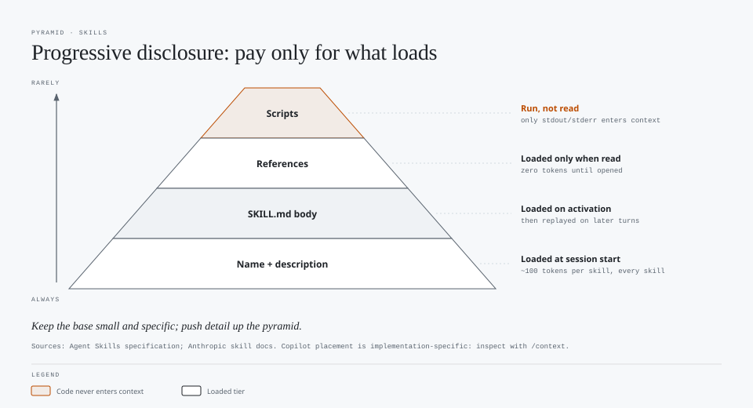

# Designing Frontmatter and Scripts for Skills, Agents, Instructions, and Prompts

Prepared October 15, 2026. Field lists were checked against the sources at the end of this document. Calculations are illustrative, and harness behavior can change between versions.

## Main conclusion

Frontmatter is **routing metadata that is paid for on every request**. Bodies are **instructions paid for only when loaded**, but they are then replayed for the rest of the session. Scripts are **deterministic work whose output, not code, enters context**.

Three design rules follow:

1. **Keep always-loaded metadata short, specific, and stable.** It sits in the cacheable prefix of every call.
2. **Keep loaded bodies lean and push detail into on-demand files.** Once loaded, a body becomes part of the history replayed on later turns.
3. **Replace repeated model reasoning with scripts that return compact, structured output.** You pay for the output, not the logic.

## 1. Where each part lands in context



| Part | When it enters context | Where it sits | Cost pattern |
|---|---|---|---|
| Skill `name` and `description` | Session start, for **every** installed skill | System prompt or tool description (stable prefix) | Paid on every call; cheap when cached, full price on a cold cache |
| Skill body (`SKILL.md`) | When the skill is activated | Conversation history | Paid once to load, then replayed on later turns |
| Skill `references/` files | Only when read | Conversation history | Zero until read |
| Skill `scripts/` | When executed | Only **stdout/stderr** enters history | Output size, not code size |
| Agent `description` | When agents are listed for selection or delegation | Prefix or tool description | Paid on every call where agents are offered |
| Agent body | When the agent runs | That agent's system prompt | Prefix for that agent's session |
| Agent `tools` and `model` | When the agent runs | Tool definitions and model selection | Tool definitions are paid every call; model sets the rate |
| `.github/copilot-instructions.md` | Every request in the repository | Prefix | Always on |
| `.instructions.md` with `applyTo` | When a matching file is created or modified | Request context | Conditional; a broad glob makes it effectively always on |
| `.instructions.md` with `description` only | When the agent judges it relevant | Request context | On demand |
| Prompt file (`.prompt.md`) | When invoked by `/name` | User message | One-time per invocation |

Anthropic documents the skill loading tiers directly: metadata is about 100 tokens per skill and loaded at startup for all skills, the body is loaded on activation, and resources are loaded as needed. Scripts can run without their contents entering context; only output consumes tokens. [1][5] Exact placement in Copilot harnesses is implementation-specific; inspect it with `/context` or request logs instead of assuming.

## 2. Frontmatter fields by file type

### Skills (`SKILL.md`, Agent Skills specification) [1]

| Field | Required | Constraint | Design guidance |
|---|---|---|---|
| `name` | Yes | 1–64 characters; lowercase letters, digits, and hyphens; no leading, trailing, or consecutive hyphens; must match the folder name | Specific and consistent, such as `comparing-run-costs`, not `helper` |
| `description` | Yes | 1–1,024 characters | What it does **and** when to use it, with trigger keywords and exclusions |
| `license` | No | Short | Name or bundled file |
| `compatibility` | No | 1–500 characters | Only if there are real requirements (runtime, network, packages) |
| `metadata` | No | String-to-string map | Version and owner; not read for routing |
| `allowed-tools` | No | Space-separated; **experimental** | Pre-approves tools; support varies by agent |

Anthropic additionally disallows XML tags and the reserved words "anthropic" and "claude" in names, and recommends third-person descriptions and a body under 500 lines. [5]

### Custom agents (`.agent.md`, GitHub) [2]

| Field | Required | Design guidance |
|---|---|---|
| `description` | **Yes** | Purpose and when to delegate; used for automatic selection |
| `name` | No | Display name |
| `tools` | No | **Omitting it enables all tools.** Use a minimal list, such as `["read", "search"]`; `[]` disables all tools |
| `model` | No | Set deliberately for cost; unset inherits the default |
| `target` | No | `vscode` or `github-copilot`; unset means both |
| `disable-model-invocation` | No | `true` prevents automatic use; use for expensive or risky agents |
| `user-invocable` | No | `false` makes the agent programmatic-only |
| `mcp-servers`, `metadata` | No | GitHub.com and CLI; not used in IDE agents |

`infer` is retired; use `disable-model-invocation` and `user-invocable`. The agent body can be at most 30,000 characters on GitHub. [2]

### Instructions (`.instructions.md`, VS Code) [3]

| Field | Design guidance |
|---|---|
| `applyTo` | Narrow glob, such as `src/api/**/*.ts`. `**` attaches it whenever any file is changed |
| `description` | Enables on-demand loading when relevant to the task |
| `name` | Display name |

`.github/copilot-instructions.md` has no frontmatter and applies to every request. Keep it to repository-wide invariants. [3]

### Prompt files (`.prompt.md`, VS Code Local harness) [4]

| Field | Design guidance |
|---|---|
| `description`, `name`, `argument-hint` | Human-facing; short |
| `agent` | `ask`, `agent`, `plan`, or a custom agent. If `tools` is set, the default becomes `agent` |
| `model` | Pin a cheaper model for routine prompts, but see the caching note in section 5 |
| `tools` | Minimal list; unavailable tools are ignored |

Prompt files are supported only in Local harness sessions in VS Code; use skills for workflows that must work across harnesses. [4]

## 3. Good and bad frontmatter

### Skill description

**Bad:**

```yaml
---
name: AI-Helper
description: Helps with AI stuff. Use for anything related to AI, models, prompts, cost, agents, or research. Updated 2026-10-15 09:14.
---
```

| Problem | Effect |
|---|---|
| Uppercase name | Invalid under the specification; may fail to load |
| Vague, overbroad trigger | Activates on unrelated tasks, loading the body and wasting context |
| Timestamp in metadata | Changes the cached prefix whenever it is edited, and adds no routing value |

**Good:**

```yaml
---
name: comparing-run-costs
description: Compares cost per accepted completion across harness runs using supplied token and acceptance data. Use when the user provides run results, JSONL logs, or asks which configuration was cheaper. Not for pricing lookups or prompt writing.
metadata:
  owner: model-demos
  version: "1.2"
---
```

It names the action, inputs, triggers, and exclusions, and contains nothing that changes between sessions.

**Undertriggering is also a cost.** A too-narrow description, such as `description: Runs compare.py`, means the agent never activates the skill and improvises the analysis with more reasoning and a higher failure rate.

### Agent

**Bad:**

```yaml
---
name: helper
description: Does reviews and other things.
model: <most expensive available model>
---
```

| Problem | Effect |
|---|---|
| No `tools` | All tools enabled; every tool definition is paid on every call and the agent can edit or execute |
| Vague `description` | Automatic delegation picks it for the wrong tasks |
| Strongest model by default | Every invocation pays the highest rate, including trivial ones |

**Good:**

```yaml
---
name: workload-reviewer
description: Reviews supplied AI-workload run results and ranks configurations by cost per accepted completion. Read-only.
tools: ["read", "search"]
model: <mid-tier model ID>
disable-model-invocation: false
---
```

For a costly agent, such as a deep research agent, set `disable-model-invocation: true` so it runs only when explicitly selected.

### Instructions

**Bad:**

```yaml
---
applyTo: "**"
---
Always use the strongest model. Explain all background. Research every provider before answering. Today is 2026-10-15.
```

**Good:**

```yaml
---
description: Use when writing or editing harness metrics or cost reports.
applyTo: "harness/**/*.py"
---
- Report failed-run spend; never omit failures.
- Keep measured values separate from estimates.
```

The good version loads only for relevant files or tasks, contains rules the model would not otherwise know, and has no date or session-specific text.

### Prompt file

**Bad:** a prompt file with no `tools` that drives the default agent with all tools and the strongest model for a simple formatting task.

**Good:**

```yaml
---
name: summarize-run
description: Summarize one harness JSONL run into a short table.
argument-hint: path to run .jsonl
agent: ask
tools: []
---
Summarize ${input:runFile} with: model, input, cached input, output, tool calls, accepted (yes/no).
```

## 4. Adding scripts

### When to script

| Use a script when | Keep it in instructions when |
|---|---|
| The operation is deterministic: parsing, validating, counting, formatting, diffing | Judgment depends on context |
| Errors are costly or the sequence is fragile | Multiple approaches are valid |
| The same code would otherwise be generated repeatedly | It happens once |
| Output can be checked by a machine | Output is prose |

Anthropic's guidance: pre-made scripts are more reliable than generated code, save tokens because code is not loaded into context, save generation time, and ensure consistency. Scripts should **solve, not defer**, by handling expected errors rather than leaving them for the model. [5]

### Layout

```text
comparing-run-costs/
  SKILL.md                 # short: when to use, which script to run, output contract
  scripts/
    summarize_runs.py      # executed; only its output enters context
    validate_runs.py
  references/
    metrics.md             # read only if the output is ambiguous
```

Say explicitly whether the agent should **run** a script or **read** it. Reading a 400-line script to understand it costs about as much as pasting it; running it costs only its output. [5]

### Good and bad scripts

**Bad:**

```python
# summarize.py
import json, sys
for line in open(sys.argv[1]):
    print(json.dumps(json.loads(line), indent=2))   # dumps every event
```

| Problem | Effect |
|---|---|
| Prints the entire log | Thousands of output tokens enter history and are replayed on every later turn |
| No validation or error handling | A malformed line raises a traceback; the agent spends turns diagnosing it |
| No defined output shape | The agent must reason over raw events to answer the question |

**Good:**

```python
"""Summarize harness runs. Usage: summarize_runs.py RUN.jsonl [--json]"""
import json, sys

REQUIRED = {"run_id", "input_tokens", "cached_tokens", "output_tokens", "accepted"}

def main(path, as_json):
    rows, errors = [], []
    with open(path, encoding="utf-8") as f:
        for n, line in enumerate(f, 1):
            try:
                event = json.loads(line)
            except json.JSONDecodeError:
                errors.append(f"line {n}: invalid JSON")
                continue
            missing = REQUIRED - event.keys()
            if missing:
                errors.append(f"line {n}: missing {sorted(missing)}")
                continue
            rows.append(event)
    if errors:
        print("\n".join(errors[:10]), file=sys.stderr)
        print(f"{len(errors)} invalid lines; fix the log before comparing.", file=sys.stderr)
        sys.exit(2)
    accepted = sum(r["accepted"] for r in rows)
    summary = {
        "runs": len(rows),
        "accepted": accepted,
        "input_tokens": sum(r["input_tokens"] for r in rows),
        "cached_tokens": sum(r["cached_tokens"] for r in rows),
        "output_tokens": sum(r["output_tokens"] for r in rows),
    }
    if as_json:
        print(json.dumps(summary, separators=(",", ":")))
    else:
        print(" | ".join(f"{k}={v}" for k, v in summary.items()))

if __name__ == "__main__":
    main(sys.argv[1], "--json" in sys.argv)
```

It validates input, returns a short and specific error with a non-zero exit code, prints a fixed-shape summary of one line, and supports compact JSON for chaining.

Note that `cached_tokens` is treated as a separate column. Confirm whether your provider reports cached tokens inside or outside the input total before adding them together. See the [prompt caching guide](prompt-caching-guidance.md).

### Script design checklist

- **Bounded output:** summaries, counts, and the first *N* errors, never raw dumps. Offer `--verbose` for humans.
- **Stable output:** deterministic ordering and no timestamps, random IDs, or absolute temp paths unless needed. Stable output is easier to compare across runs and avoids gratuitous differences in replayed history.
- **Actionable errors:** say what is wrong and how to fix it, and exit non-zero. Vague failures trigger agent retry loops.
- **Documented dependencies:** state the runtime and packages in `SKILL.md` or `compatibility`. Do not assume they are installed. [1][5]
- **Safe by default:** read-only unless the skill's purpose is to change things; a dry-run flag for destructive operations; no secrets in output.
- **Plan, validate, execute:** for batch or destructive changes, have the agent write a plan file, validate it with a script, then apply it. [5]

## 5. How design choices affect caching

| Choice | Caching effect |
|---|---|
| Stable frontmatter and always-on instructions | Prefix stays identical, so later calls can read it from cache |
| Timestamps, counters, or "last updated" in always-on text | Any change invalidates the cache for that content and everything after it |
| Installing, removing, or editing skills or agents | Changes the prefix the next time the harness rebuilds it; whether that happens mid-session varies by harness |
| Agent or prompt file with a different `model` or `tools` used **in the main session** | Changing model or tools mid-session invalidates the cache [6] |
| The same agent run as a **subagent** | Runs in a separate context; the main agent's cache is preserved [6] |
| Activating a skill | Body is appended to history; the earlier prefix stays cached, but the body is replayed later |
| Large script output | Appended to history; cached on later turns but still replayed |
| `applyTo: "**"` | Attached on most edits; behaves like always-on context |

**Practical rule:** put stable text first, put variable text last, and change model, tools, or effort only at session boundaries or through subagents.

## 6. How design choices affect cost

Illustrative per-call prefix cost from metadata alone, before any task content:

| Setup | Skill metadata | Tool definitions | Always-on instructions | Prefix |
|---|---:|---:|---:|---:|
| Lean | 10 skills x 80 tokens = 800 | Scoped tools: 3,000 | 300 | About 4,100 |
| Bloated | 60 skills x 250 tokens = 15,000 | All tools and MCP servers: 25,000 | 4,000 | About 44,000 |

Over a 40-call agent session, the bloated prefix sends about 1.6 million more input tokens than the lean one. Caching discounts most of that if the prefix is stable and calls stay within the cache lifetime, but the cache write and every cold start pay full price. These numbers are illustrative; measure your own prefix with `/context` or provider usage fields.

Other cost effects:

- **Overtriggering** loads unneeded bodies, increasing history for the rest of the session.
- **Undertriggering** forces the model to improvise work a script would do cheaply, often with retries.
- **Unscoped `tools`** add tool definitions to every call and widen the range of actions an agent might take.
- **A pinned expensive `model`** on a frequently used agent or prompt multiplies the rate for every invocation.
- **Verbose script output** grows history, which is replayed on every subsequent turn.

## 7. How design choices affect task outcomes

| Design | Likely outcome |
|---|---|
| Specific description with triggers and exclusions | Right skill or agent selected; fewer detours |
| Vague or overbroad description | Wrong skill loaded, or conflicting skills loaded together |
| Short body with linked references | Agent reads only what it needs; less instruction dilution |
| Long monolithic body | Important rules buried; more context competing for attention |
| Deterministic script with a defined output contract | Repeatable results that can be checked automatically |
| Model-generated logic every time | Inconsistent results between runs |
| Minimal `tools` | Smaller blast radius; the agent cannot drift into unrelated edits |
| Conflicting instructions across files | Unpredictable behavior; harder to debug |

These are hypotheses. Test them in the harness.

## 8. Harness experiments

Use the [agent-assets library](../agent-assets/README.md) and the [prompt library](../prompts/README.md). Change one variable per experiment:

| Experiment | Variable | Measure |
|---|---|---|
| Description quality | Specific vs vague vs too narrow description | Activation precision and recall, tokens, acceptance |
| Skill count | 5 vs 50 installed skills, same task | Prefix tokens, cold vs warm cost, selection accuracy |
| Script vs no script | Skill that runs `summarize_runs.py` vs one that describes the logic | Output tokens, tool calls, correctness, variance across runs |
| Script output size | Summary vs raw dump | History growth per turn, total input |
| Agent tool scope | `["read", "search"]` vs unset | Tool-definition tokens, unintended edits, acceptance |
| Model pinning | Inherited vs pinned model on a routine agent | Cost per accepted completion |
| Volatile metadata | Stable vs timestamped always-on instructions | Cache read ratio across consecutive sessions |
| `applyTo` breadth | Narrow glob vs `**` | Instruction attach rate, tokens |

Record ordinary input, cache reads, cache writes, output, calls, tool calls, activations, and acceptance. Report cost per accepted completion.

## 9. Design checklist

- [ ] `name` is valid and matches the folder; `description` states what, when, and when not.
- [ ] No timestamps, counters, or session-specific text in frontmatter or always-on instructions.
- [ ] `tools` is set explicitly and minimally on agents and prompt files.
- [ ] `model` is pinned only when deliberate; expensive agents use `disable-model-invocation: true`.
- [ ] `applyTo` globs are as narrow as the rule.
- [ ] `SKILL.md` body is short; detail lives in one-level-deep `references/`.
- [ ] Deterministic steps are scripts; instructions say whether to **run** or **read** each one.
- [ ] Scripts validate input, bound output, exit non-zero with actionable errors, and document dependencies.
- [ ] Changes are tested with every model class you plan to use. [5]

## Sources

1. [Agent Skills specification](https://agentskills.io/specification)
2. [GitHub: Custom agents configuration](https://docs.github.com/en/copilot/reference/custom-agents-configuration)
3. [VS Code: Use custom instructions](https://code.visualstudio.com/docs/agent-customization/custom-instructions)
4. [VS Code: Use prompt files](https://code.visualstudio.com/docs/agent-customization/prompt-files)
5. [Anthropic: Skill authoring best practices](https://platform.claude.com/docs/en/agents-and-tools/agent-skills/best-practices)
6. [GitHub: Optimizing your AI usage](https://docs.github.com/en/copilot/tutorials/optimize-ai-usage)
