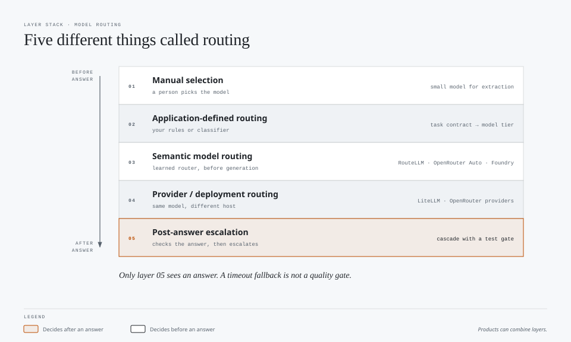
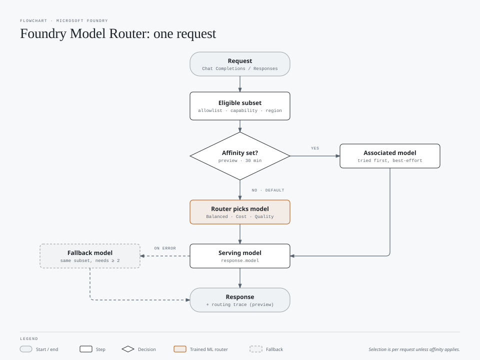
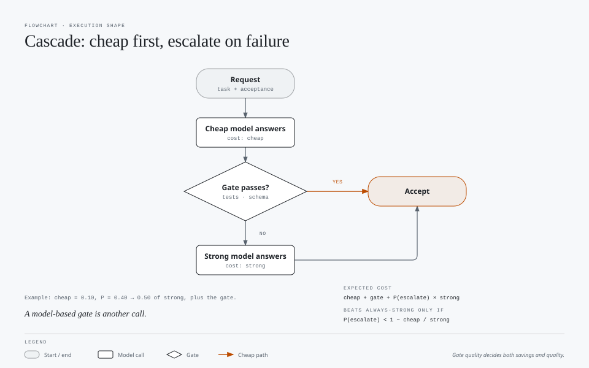

# Fact Check: Model Selection, Routers, and Execution Shapes

Prepared October 15, 2026, from two presentation slides. Expanded with application-defined routing, third-party routers, and Microsoft Foundry Model Router. Product claims were checked against the primary sources below. Calculations are illustrative; no live inference benchmarks were run. Product behavior, routing pools, and pricing can change.

## Summary

| Slide claim | Verdict | Correction |
|---|---|---|
| Manual: cost = tokens x cost | **Simplified** | Cost = each token type x its own rate (ordinary input, cache reads/writes, output including reasoning), summed over every model call in the session |
| Auto: "Model selects based on estimate" | **Misleading** | A **router** selects the model, using estimated task complexity **and** real-time system health and availability [1] |
| Auto: "Next prompt might use same model" | **Needs precision** | GitHub documents routing along natural cache boundaries and large drifts in conversation complexity; it does not publish a model-retention percentage [1] |
| Auto: "(Tokens) x Model(s) Cost - 10%" | **Correct in substance** | Usage is charged at the selected model's rate with a **10% discount on paid plans** in Copilot Chat, CLI, the Copilot app, and cloud agent. Write it as `x 0.9`, not `- 10%` [1] |
| Single → Cascade → Critique | **Valid shapes, misleading arrows** | These are alternatives, not a progression. Each can be more or less expensive depending on gate accuracy and loop caps |
| "Ensemble" title | **Imprecise** | Cascade and critique are sequential. Ensembles usually mean parallel answers combined by voting or a judge, which the slide does not show |
| Strikethrough "Hydra" | **Good call** | Use descriptive names, not internal codenames, on external slides |
| "escalcate" | **Typo** | "escalate" |
| "A router always chooses between different models" | **False** | A gateway can route between providers or deployments of the **same** model; semantic model selection is a different capability [7][10] |
| "Foundry Model Router is Copilot Auto on Azure" | **False** | Separate products, configuration, billing, and session behavior; Copilot's Auto discount does not carry over [1][11][12] |

**Bottom line:** choose who owns model selection separately from how work executes. A developer, rule, learned router, or managed service can select a model; that model can then participate in a single call, cascade, critique loop, or ensemble.

## Slide 1: Manual model and Auto

### What the slide gets right

- With manual selection, the developer chooses the model and its applicable rates, unless the developer changes it or the harness invokes separately configured subagents. This does not fix the total session cost.
- Auto selects a model per prompt, and you pay that model's rate with a 10% discount on paid plans. [1]

### Corrections and missing points

1. **The router decides, not the model.** Auto combines a task-complexity evaluator with real-time health and availability signals. [1]
2. **Tiers change the preference, not the model pool.** Efficiency prioritizes cost, Balance weighs cost, quality, and latency, and Intelligence prioritizes quality. The same models are available in every tier. Tiers are available only in VS Code, Copilot CLI, and the Copilot app. [1]
3. **Auto is cache-aware.** A different model cannot reuse the previous model's processed-prefix cache. This is loss of reuse for the switched request, not necessarily deletion of the previous cache entry. GitHub says Auto routes along natural cache boundaries and large complexity changes to avoid additional cache costs without quality improvements. [1] Do not turn this into an undocumented promise that it keeps one model for most turns.
4. **Auto is not always cheaper.** If you manually choose a lightweight model for a routine task, it can cost less than Auto even after the discount. Auto saves when developers would otherwise default to a strong model for everything.
5. **Policies apply.** Auto chooses only models allowed by your plan and administrator policies. For individuals, it may serve evaluation models unless disabled. [1]
6. **You can see which model was used** for each response in Chat, the app, CLI, and cloud agent. Use this when measuring. [1]

### Suggested slide text

| Manual | Auto |
|---|---|
| Developer chooses model | Developer chooses Auto (and a tier where available) |
| Prompt → answer | Router picks a model from task complexity and system health |
| Cost = tokens by type x chosen model's rates | Routing considers natural cache boundaries and large complexity changes |
| Risk: overpaying with a strong default | Cost = tokens by type x selected model's rates x 0.9 (paid plans) |

## Beyond Copilot Auto: manual, third-party, and Foundry routers

### Separate the routing layers



| Layer | Decision | Example | What it does not establish |
|---|---|---|---|
| Manual selection | A person chooses the model | Select a lightweight model for extraction | Automatic adaptation to task difficulty |
| Application-defined routing | Developer-owned rules or a classifier choose an eligible model | Known classification jobs use a small model; other jobs use a general model | That prompt length alone predicts difficulty |
| Semantic model routing | A learned router predicts the suitable model before generation | RouteLLM, OpenRouter Auto, Foundry Model Router | That it generated and checked several answers |
| Provider/deployment routing | Select the host, region, or deployment for a chosen model | LiteLLM load balancing, OpenRouter provider routing | That it selected a different model based on difficulty |
| Post-answer escalation | Accept or reject a first answer and possibly invoke another model | A cascade with a test gate | The same behavior as pre-answer routing |

A product can combine these layers. **Fallback for a timeout is not a quality gate:** it addresses an operational failure, not a plausible but incorrect answer.

### Developer-owned or "manual" routers

Manual model selection is not itself an automated router. A developer can, however, encode a routing policy in the application:

```text
Request
  -> filter models by policy, context length, tools, and output requirements
  -> known, evaluated extraction task: lightweight model
  -> general task: mid-tier model
  -> difficult or high-impact task: strong model or explicit review
  -> validate the result; stop, report a blocker, or escalate within a cap
```

This is an illustrative design, not a vendor configuration format. Keep the selection policy in versioned configuration; a prompt saying "use a cheaper model" does not change an API's model parameter.

**Cost:** rules need no LLM call, but still have execution and maintenance costs. A model-based classifier adds inference cost and latency. Include retries, validation, and any escalation in the comparison.

**Common failure:** routing by token count or keyword alone. A short mathematical proof can be harder than a long extraction task. Prefer known task contracts and held-out evaluations over a universal "short prompt = cheap model" rule.

**Best fit:** stable, well-understood workloads, strict allowlists, and applications that need auditable routing behavior. Pin a compatible model/deployment for a conversation when continuity matters; do not assume that identical model names across providers imply a shared cache.

### Third-party examples: different routing capabilities

| Product | Verified capability | Cost and cache implications |
|---|---|---|
| **LiteLLM Router** | Deployment load balancing, retries, cooldowns, fallbacks, and strategies including latency and lowest cost. Default is `simple-shuffle`, not a semantic task-difficulty classifier. [7] | Inference, proxy infrastructure, and any commercial service costs remain. Distributing requests across endpoints can reduce prefix-cache reuse; inspect the strategy rather than assuming cache affinity. |
| **RouteLLM** | Open-source learned routing between a strong and weak model, with a threshold calibrated to representative prompts. Multiple router implementations are available. [8] | Serving the router is not free. The documented `mf` and `sw_ranking` implementations also require embeddings through OpenAI, adding a dependency and possible inference cost. Reported benchmark savings are not a guarantee for a new model pair or workload. |
| **OpenRouter Auto** | `openrouter/auto` classifies the task and ranks eligible models using trailing seven-day aggregate spend-share signals, filtered by cost tier, capabilities, and restrictions. This is the current documented design, not an independent accuracy guarantee. [9] | Standard rate of the selected model, with no extra **Auto Router** fee. Credit-purchase and applicable BYOK fees are separate. Session stickiness can retain a model while it remains a current candidate. [9][15] |
| **OpenRouter provider routing** | Chooses a provider for the requested model using availability, price, and configurable preferences. This is distinct from `openrouter/auto`. [10] | Provider sticky routing helps reuse the same endpoint's cache. Provider changes can lose that reuse even without changing the model name. [16] |

OpenRouter's `cost_tier` values are `low`, `medium`, `high`, `xhigh`, and `max`. They select **cost bands**, not reasoning-effort budgets or hard per-request spend caps. Its docs identify `cost_quality_tradeoff` as a deprecated setting; copied examples may describe an older router. [9]

**Privacy boundary:** an external hosted gateway adds another service that handles requests. Before using it, verify approved providers, regions, retention, and contractual requirements. A self-hosted gateway does not remove the underlying model provider's policies.

### Microsoft Foundry Model Router

The product formerly described in Azure AI Foundry documentation is now documented as **Microsoft Foundry Model Router**. Deploy `model-router` as one model deployment and send inference requests to it. It selects an eligible underlying model rather than synthesizing an ensemble of answers. [11][13]


| Setting or behavior | Verified fact | Practical consequence |
|---|---|---|
| Routing modes | **Balanced** (default), **Cost**, **Quality**. Quality prioritizes predicted response quality regardless of cost. [11][12] | These are routing objectives, not model reasoning-effort settings or spending caps. |
| Model subset | Restrict the eligible models; new models are not automatically added to an explicit inclusion list. [11] | Use an allowlist for policy, capability, and reproducibility constraints. |
| Versioning | The current documented version is `2025-11-18`; it receives model and feature updates without changing that identifier. Older `2025-08-07` and `2025-05-19` versions are frozen. [11] | A fixed router version alone does not freeze the underlying pool. Record the subset and actual serving model. |
| Underlying models | The current pool spans multiple providers, including OpenAI, Anthropic, DeepSeek, Meta, and xAI. Eligibility varies with region, access, and deployment type. [11] | It is neither OpenAI-only nor an unrestricted router across every model in the catalog. |
| Separate deployments | Underlying models generally need no separate deployment, **except Claude models**, which must first be deployed from the catalog. [11] | Do not promise a universally configuration-free multi-provider pool. |
| APIs and tools | The usage guide includes Chat Completions and Responses API examples. Eligible models support agentic/tool scenarios. [11][13] | Validate required parameters, tool behavior, and output formats across the selected subset. |
| Default session behavior | Selection repeats for each request; separate Chat Completions turns may select different models. [12] | One endpoint does not mean one serving model throughout a conversation. |
| Session affinity | Optional **Chat Completions preview** attempts the associated eligible model first. Association expires after 30 minutes without a successful create/update. Policy, capability, availability, and fallback can override it. [12][13] | Best-effort continuity, not a guarantee of a fixed model, a cache hit, or adaptive cache-aware switching. |
| Caching | Uses supported underlying-model caches; reuse depends on model selection and overlapping prefixes. Affinity does not inspect cache state. [11][12] | Do not transfer Copilot Auto's documented cache-boundary policy to Foundry. |
| Automatic fallback | Enabled by default; a custom subset is also the fallback set. At least two models are needed to benefit from fallback. [11] | A one-model subset gives no alternative-model fallback. |
| Context and modalities | Effective context is constrained by the smallest underlying model; use a compatible subset. Image input is supported, but routing is based on text; audio input is not supported. [11] | Filter for capabilities before evaluating cost or quality. |

**Architecture wording needs care:** Microsoft's concept overview calls the router a "trained language model," while its dedicated architecture article explicitly calls it a lightweight trained ML model, **not an LLM itself**. Use "trained ML router" on slides rather than implying a full answer-generation LLM call. [11][12]

**Observability:** `response.model` identifies the serving model. Optional preview metadata exposes `model_selection_details.model_router_details`, including routing mode, ordered attempts, latency, and affinity decisions. Microsoft documents `Foundry-Features: ModelRouterControls=V1Preview` for this metadata. Fields can be absent; do not invent an explanation for a missing trace. [14]

**Billing fact check:** Copilot's 10% Auto discount is **not** a Foundry discount. The Foundry concept page states that model-router input prompts are charged at the pricing-page rate. The public pricing page fetched during this review did not expose usable numeric router rates, so this document does not claim a free router, a particular surcharge, or a universal savings percentage. Confirm router and serving-model meters against the current Azure price sheet and observed Cost Management charges before publishing a dollar estimate. [1][11][18]

### Compare cost at the session level, not just the selected rate

```text
End-to-end cost =
    billed inference across all attempts
  + router/classifier/embedding charges, where applicable
  + gateway, hosting, or account fees, where applicable
  + validation, critique, and escalation calls
```

Count cached reads and writes at their actual rates; do not add a hypothetical "cache penalty" on top of already measured usage. Switching to a cheaper model can still make a long session more expensive if it loses enough cached-prefix reuse. Conversely, switching can be worthwhile when the lower rate or quality improvement outweighs that cost.

| Option | Choose it when | Do not assume |
|---|---|---|
| Manual fixed model | Task and model choice are known; reproducibility matters | Cheapest price per token means cheapest accepted result |
| Developer-owned routing | Task classes are stable and explicit policy is important | Handwritten rules generalize to every task |
| Copilot Auto | Working inside supported Copilot surfaces with mixed tasks | Its discount or tiers apply to unrelated gateways |
| Third-party gateway/router | Building an application that needs multi-provider access or custom routing | A load balancer is automatically an intelligent model selector |
| Foundry Model Router | Building on Azure and wanting managed per-request model selection within an eligible pool | It exposes the same model pool, cache behavior, or billing as Copilot Auto |

These application API routers are not automatically selectable backends for every Copilot surface. Verify each harness's endpoint and authentication support; an OpenAI-compatible API alone does not establish that integration.

### Validation plan for this repository's cost harness

Compare a cheap fixed model, a strong fixed model, developer-defined routing, and the managed routers you actually use. Keep tasks, acceptance criteria, tools, output limits, and grading consistent where supported. Run both one-shot and multi-turn cases, with cold and warm-cache trials separated. Microsoft's evaluation guide recommends a representative workload, meaningful baseline, category-level quality checks, and cost/latency/policy acceptance criteria. [17]

Record requested router/model, router version, mode/tier, eligible subset, actual serving model and provider/deployment when exposed, routing attempts, cached/ordinary input, output/reasoning usage, billed charges, latency, and acceptance. Include classification, embedding, judging, and failed-attempt costs where billed. Report **total cost per accepted completion**, not an advertised router savings percentage.

## Slide 2: Execution shapes

### Single

One request, one model, one answer. Cost is approximately one call. It is the baseline every other shape must beat on **cost per accepted answer**.

### Cascade

A cheap model answers first; a decision gate either accepts the answer or escalates to a stronger model.



```text
Expected cost = cheap call + gate cost + P(escalate) x strong call
```

Ignoring gate cost, cascading beats always using the strong model only when:

```text
P(escalate) < 1 - (cheap cost / strong cost)
```

**Illustrative example:** If the cheap model costs 10% of the strong model, cascading saves money only while fewer than 90% of requests escalate. If it escalates 40% of the time, expected cost is `0.10 + 0.40 = 0.50` of always using the strong model, plus the gate.

What makes or breaks it:

- **Gate quality.** A gate that accepts wrong answers saves money while lowering quality. A gate that escalates too often adds cost. Deterministic gates (tests, schema validation, compilers) are cheaper and more reliable than asking a model to rate its own confidence.
- **Gate cost.** A model-based judge is another call.
- **Context reuse.** Escalation repeats input processing on a different model, so the cheap model's cache does not help the strong model.

FrugalGPT reported large cost reductions with LLM cascades on its benchmarks. [2] Results depend on the task and gate; measure before claiming a percentage.

**Cascade vs Auto:** Auto routes **before** answering. A cascade decides **after** a first answer, based on its quality. They can be combined.

### Critique ("rubber duck")

A model answers, a critic reviews it, and the answer is revised, repeating until a stop condition.

```text
Cost ≈ answer + rounds x (critique + revision), with each round replaying the growing context
```

What makes or breaks it:

- **A stop rule is mandatory.** Cap rounds (for example, one or two) and stop when the critic finds no material issue. Without one, the loop has no natural endpoint.
- **External signals beat self-assessment.** Self-Refine reported gains from iterative self-feedback on several tasks. [3] Huang et al. found that without external feedback, models often fail to improve, and can degrade, when self-correcting reasoning. [4] Prefer critics grounded in tests, sources, or a different model.
- **Critic model choice.** A separate, focused critic (for example, Copilot CLI's rubber-duck review agent) runs in its own context, avoiding changes to the main session's model and cache. [5]
- **Bounded critique.** Ask for the top few material issues, not every possible improvement.

### Missing shape: parallel ensemble

If the title keeps "ensemble," add the parallel shape:

```text
Request → k answers (same or different models) → vote or judge → answer
Cost ≈ k x single + judge
```

Self-consistency voting is the classic example. [6] It multiplies cost by roughly `k` and is worthwhile only when the answer can be compared or verified.

### Suggested slide structure

| Shape | Steps | Cost | Use when |
|---|---|---|---|
| Single | Request → model → answer | 1x | Task is clear and the model is reliable |
| Cascade | Cheap answer → gate → accept or escalate | Cheap + gate + P(escalate) x strong | A cheap verifier exists and most requests are easy |
| Critique | Answer → critic → revise (capped) → answer | Grows with rounds | Errors are costly and the critic has external evidence |
| Parallel ensemble | k answers → vote or judge | About k x single | Answers are comparable and accuracy matters more than cost |

Replace the downward arrows with "choose by task" so the slide does not imply each shape builds on the previous one.

## Presenter challenges

1. "Auto is 10% cheaper." Than what? Than the same model chosen manually, yes. Than a lightweight model you chose deliberately, not necessarily.
2. "Auto picks a new model each prompt." It is designed to avoid switching except at cache boundaries or large complexity changes.
3. "Cascades always save money." Only below the break-even escalation rate and with a cheap, accurate gate.
4. "Critique improves quality." With external feedback, often. Self-critique alone can stall or regress on reasoning.
5. "These shapes are an ensemble." Only the parallel shape is an ensemble in the usual sense.
6. "We use a model router." Does it choose a different model, or just another endpoint for the same model?
7. "Foundry keeps the model warm." Is Chat Completions session affinity enabled, did the model stay eligible, and did the usage fields actually show cache reads?
8. "Routing saved 30%." Against which fixed-model baseline, at what acceptance rate, and including which fees, cache conditions, and fallback attempts?

## Related

- Prompt patterns: [design-debate](../prompts/design-debate/), [endless-debate-loop](../prompts/endless-debate-loop/), [code-review](../prompts/code-review/)
- [AI workloads and cost](ai-workloads-cost.md)
- [Harnesses and effort](harnesses-and-effort.md)
- [Prompt caching guidance](prompt-caching-guidance.md)

## Sources

1. [GitHub: About Copilot auto model selection](https://docs.github.com/en/copilot/concepts/models/auto-model-selection), checked October 15, 2026
2. [Chen, Zaharia, and Zou, 2023: FrugalGPT](https://arxiv.org/abs/2305.05176)
3. [Madaan et al., 2023: Self-Refine](https://arxiv.org/abs/2303.17651)
4. [Huang et al., 2023: Large Language Models Cannot Self-Correct Reasoning Yet](https://arxiv.org/abs/2310.01798)
5. Copilot CLI 1.0.98 built-in agent types, including `rubber-duck` for reviewing plans and implementations
6. [Wang et al., 2022: Self-Consistency Improves Chain of Thought Reasoning](https://arxiv.org/abs/2203.11171)
7. [LiteLLM: Routing, load balancing, and fallback strategies](https://docs.litellm.ai/docs/routing)
8. [LMSYS: RouteLLM repository and implementation guidance](https://github.com/lm-sys/RouteLLM)
9. [OpenRouter: Auto Router](https://openrouter.ai/docs/guides/routing/routers/auto-router)
10. [OpenRouter: Provider routing](https://openrouter.ai/docs/guides/routing/provider-selection)
11. [Microsoft Learn: Model router concepts, versions, supported models, caching, and limitations](https://learn.microsoft.com/en-us/azure/foundry/openai/concepts/model-router)
12. [Microsoft Learn: How model router works](https://learn.microsoft.com/en-us/azure/foundry/openai/concepts/model-router-how-it-works)
13. [Microsoft Learn: Use model router; session affinity preview](https://learn.microsoft.com/en-us/azure/foundry/openai/how-to/model-router)
14. [Microsoft Learn: Monitor model router; routing and affinity metadata preview](https://learn.microsoft.com/en-us/azure/foundry/openai/how-to/monitor-model-router)
15. [OpenRouter: Pricing and fees FAQ](https://openrouter.ai/docs/faq)
16. [OpenRouter: Prompt caching and provider sticky routing](https://openrouter.ai/docs/guides/best-practices/prompt-caching)
17. [Microsoft Learn: Evaluate model router for your workload](https://learn.microsoft.com/en-us/azure/foundry/openai/how-to/evaluate-model-router)
18. [Azure: Azure OpenAI pricing](https://azure.microsoft.com/en-us/pricing/details/azure-openai/)

Sources 7-18 were checked October 15, 2026. Provider descriptions establish documented behavior, not independently measured quality or savings.
