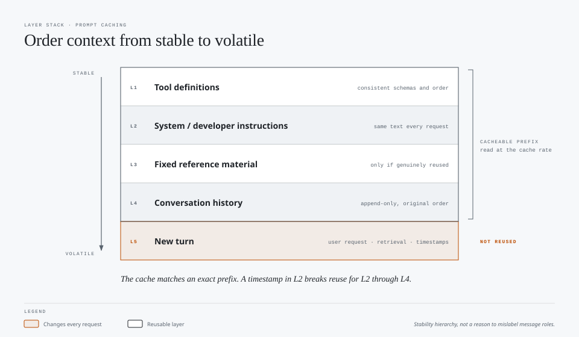

# Prompt Caching: Fact-Check and Optimization Guide

Prepared October 15, 2026. Provider behavior and pricing are model-specific and may change.

## Core principle

**Put stable content first and changing content later, within the ordering supported by the provider.** Prompt caching reuses computation for an eligible, matching prompt prefix; it does not retrieve an old answer or avoid generating a new response.

A change prevents reuse of the old prefix beyond that point. Earlier eligible prefixes may still be reusable if they were cached and the provider can find them.

Caching reduces the price and processing cost of eligible input. Cached content still occupies the model's context window, and output generation is charged separately.

## Fact-check of the slide

| Claim or implication | Assessment | Correction |
|---|---|---|
| Stable content should precede changing content | Correct | Maximize the reusable prefix while preserving message roles and provider-required ordering. |
| A timestamp at the beginning breaks caching | Conditional | A different timestamp on each request prevents matching beyond it. A date-only value changes daily rather than every request. |
| The "Common" layout represents actual API order | Misleading | Applications cannot freely reorder every field. Anthropic processes tools, system instructions, then messages. The realistic mistake is putting changing metadata near the beginning of the system instructions. [2] |
| Retrieved documents are the same across requests | Conditional | A fixed reference set can be stable. Per-query retrieval results usually change and belong after the stable prefix. |
| Documents should precede system instructions | Not a general rule | Keep stable instructions before changing documents where the API permits. On Anthropic, system instructions precede messages by design. |
| Conversation history is not reusable | Incorrect | Unchanged earlier turns can be reused as the conversation grows. Editing, truncating, or compacting history changes the prefix. [2] |
| The illustrated token counts prove savings | Incorrect | They are plausible examples, not measurements. Eligibility, cache lifetime, routing, breakpoints, and actual read/write usage determine savings. |

## Recommended conceptual layout

This is a stability hierarchy, not permission to flatten or reorder system, user, and tool messages.



```text
Stable tool definitions, with consistent schemas and ordering
Stable system/developer instructions
Fixed reference material, if genuinely reused
Unchanged conversation history, in its original order
New turn: user request, per-query retrieval, and changing metadata
```

Keep changing metadata out of the reusable prefix. Include it in an appropriate message or block for the current turn; do not mislabel trusted instructions or tool results as user content just to improve caching.

For a conversation, append new turns rather than rewriting earlier ones. A timestamp that was appended in a previous turn can become part of reusable history if it remains unchanged. Updating that historical timestamp on every request destroys that benefit.

## Provider differences

### OpenAI API

The current documentation distinguishes GPT-5.6 and later from earlier models. [1]

For GPT-5.6 and later:

- Minimum cacheable prefix: 1,024 visible input tokens.
- Cache writes cost 1.25 times the ordinary input-token rate.
- Reads cost 0.1 times that rate on most of these models and 0.05 times on GPT-6.1 Sol.
- Both implicit and explicit breakpoints are supported.
- The default and currently supported minimum lifetime is 30 minutes after the most recent write or reuse.
- In explicit-only mode, content after the last selected breakpoint is processed at the ordinary input rate without a cache-write charge.
- A request can create up to four cache writes. Implicit caching uses one slot when combined with explicit breakpoints.

Explicit-only configuration uses:

```json
{
  "prompt_cache_options": {
    "mode": "explicit"
  }
}
```

Supported input content blocks can carry:

```json
{
  "prompt_cache_breakpoint": {
    "mode": "explicit"
  }
}
```

These fragments are configuration illustrations, not a complete API request. Top-level `instructions` cannot contain a breakpoint. To mark reusable developer instructions explicitly, put them in a supported content block inside a developer message. [1]

Earlier OpenAI models have different cache boundaries and retention behavior and support only implicit caching. GitHub's current pricing table lists no cache-write charge for earlier OpenAI models. Check the specific model rather than applying the newer rules universally. [1][3]

Cache reuse also depends on model, request settings, processing region, cache availability, and routing. Identical visible text alone does not guarantee a hit. For older models, a stable `prompt_cache_key` can help routing; for GPT-5.6 and later, OpenAI handles cache routing automatically and keys can separate cache accounting. [1]

### Anthropic API

Anthropic caches prefixes in the order **tools → system → messages**. [2]

- Automatic caching is enabled with a top-level `cache_control` field.
- Explicit breakpoints put `cache_control` on individual supported blocks.
- Automatic caching moves its breakpoint forward as the conversation grows.
- Up to four breakpoint slots are available; automatic caching uses one when combined with explicit breakpoints.
- The default lifetime is five minutes, refreshed on reuse. A one-hour option is available.
- Five-minute writes cost 1.25 times the base input rate; one-hour writes cost twice that rate.
- Read rates and minimum cacheable lengths depend on the model. Do not assume one universal read discount.

Automatic caching configuration:

```json
{
  "cache_control": {
    "type": "ephemeral"
  }
}
```

The lifetime starts when the request begins, not when its response finishes. A four-minute response consumes most of a five-minute cache lifetime. Platform support and model-specific thresholds also matter. [2]

## Illustrative savings calculation

The slide totals approximately 27,600 input tokens:

| Component | Tokens |
|---|---:|
| Tool definitions | 15,000 |
| Reference documents | 6,000 |
| System instructions | 1,000 |
| Conversation history | 5,000 |
| Current turn | 500 |
| Current information | 100 |
| **Total** | **27,600** |

For the following arithmetic, assume:

- A previously written, still-eligible prefix of 26,000 tokens is reused.
- The remaining 1,600 tokens are new.
- Cache reads cost 0.1 times ordinary input and writes cost 1.25 times ordinary input.
- All 1,600 new tokens are written, with no additional ordinary-input tokens.
- The comparison excludes output costs and the earlier cost of creating the reusable prefix.

```text
No-cache input cost:
27,600 × 1.0 = 27,600 ordinary-input-token cost equivalents

Warm-cache input cost:
(26,000 × 0.1) + (1,600 × 1.25) = 4,600 equivalents

Warm-request input saving:
1 - (4,600 / 27,600) ≈ 83.3%
```

**This is an illustrative warm-request input saving, not an 83.3% reduction in total workflow cost.** Initial writes, misses, output, retries, and other calls must be included in the workflow result.

The 26,000/1,600 split is an assumption, not a quantity established by the slide. The actual split depends on which history was present in the previous request and where eligible breakpoints occur.

### When caching can cost more

If a changing timestamp precedes all reusable content, and all 27,600 tokens are written at 1.25 times the input rate on every request:

```text
27,600 × 1.25 = 34,500 equivalents
```

That is 25% more than processing the same input at the ordinary rate without caching. This requires both a cache-write premium and repeated writes without useful reads. It is not a universal penalty for a cache miss.

An earlier cached tool prefix may still be reusable. Explicit-only configuration can avoid writing changing content. Older OpenAI models without a write premium do not incur this particular penalty. [1][2][3]

### Break-even for a reusable prefix

Let:

- `W` be the write-price multiplier.
- `R` be the read-price multiplier.
- `N` be the total number of uses, including the first write.

Assuming one write, identical full-prefix reads, no expiry, and no other costs:

```text
Cached prefix cost = W + (N - 1) × R
Ordinary prefix cost = N

Caching saves money when:
N > (W - R) / (1 - R)
```

At `W = 1.25` and `R = 0.1`, one write followed by one read is already cheaper than two ordinary inputs: `1.35` versus `2.0`. At `W = 2.0` and `R = 0.1`, at least three total uses are needed for a saving.

Repeated expirations or prompt changes add writes and change the calculation.

## Optimization when you control the API

1. **Stabilize the prefix.** Keep per-request timestamps, IDs, randomized content, and query-specific retrieval out of early instructions.
2. **Keep tool definitions consistent.** Avoid unnecessary changes to tool names, descriptions, schemas, and ordering. Select an appropriately small tool set, then keep it stable within the workflow.
3. **Separate fixed references from retrieval.** Cache fixed reference material when reused. Put changing retrieval after the stable content.
4. **Preserve history accurately.** Append turns without rewriting prior messages. Compact when the context or quality benefit justifies rebuilding the cache; do not preserve irrelevant history solely for hits.
5. **Use supported breakpoints deliberately.** Protect long-lived prefixes before sections that change more frequently. Avoid paying to write a suffix unlikely to be reused.
6. **Choose lifetime based on reuse.** Compare longer-lived write costs with expected reuse and expiry. Do not send artificial keep-alive model requests without demonstrating net savings.
7. **Keep model and settings stable where useful.** Model switching and some request-setting changes prevent reuse. A cheaper model can still be the better choice despite a cold cache.
8. **Measure usage, not just prompt length.** Record reads, writes, ordinary input, output, and total workflow cost.

Do not add irrelevant text to reach a cache threshold or retain a large unnecessary prefix just to report a higher hit rate. The objective is lower cost per accepted completion, not maximum cached tokens.

## Optimization when using Copilot

Copilot manages provider requests and cache configuration. Editing a Markdown instruction file cannot directly set provider cache breakpoints, retention, or the final rendered prompt order.

Practical user-level actions:

- Avoid unnecessary mid-workflow changes to models, tools, MCP configuration, and instructions.
- Keep repository guidance concise and stable. Load specialized material only when relevant.
- Preserve useful session continuity, but compact or start fresh when irrelevant context, stale assumptions, or quality problems justify it.
- Batch naturally related work rather than fragmenting it into disconnected sessions purely by habit.
- Do not keep an unproductive session running merely to preserve a cache.

These actions can reduce avoidable prefix changes, but none guarantees a hit. GitHub documents Auto routing at natural cache boundaries to avoid unnecessary cache costs. Users do not control that routing directly. [4]

Avoid universal claims such as "Copilot caches for five minutes." Lifetime depends on the model, provider, and product integration; direct API defaults do not establish Copilot's exact configuration.

## Measurement checklist

Compare identical task inputs and acceptance criteria under cold and warm conditions.

| Measure | Purpose |
|---|---|
| Model, provider/product, settings, and pricing date | Make results reproducible and prices interpretable. |
| Cache-read tokens | Confirm actual reuse rather than inferred eligibility. |
| Cache-write tokens, where reported | Account for initial creation and repeated writes. |
| Ordinary input tokens | Identify input that received no cache discount. |
| Output/reasoning usage as exposed by the provider | Prevent input savings from hiding increased generation cost. |
| Request intervals and expirations | Explain missed reuse and lifetime tradeoffs. |
| Completion rate and total workflow spend | Verify savings without silently reducing quality. |

OpenAI reports cache reads through `cached_tokens` in its input usage details. Anthropic reports `cache_read_input_tokens` and `cache_creation_input_tokens`. Provider token fields can overlap or represent different categories, so follow each provider's accounting definitions rather than summing every field blindly. [1][2]

## Recommended slide revision

**Title:** Prompt caching: preserve the reusable prefix.

Replace "Good" versus "Common" with **stable prefix** versus **early-changing metadata**.

Show a realistic provider-specific example:

```text
Better:
Tools → stable system instructions → fixed references
→ unchanged history → new request and current metadata

Worse:
Tools → system instructions beginning with a changing timestamp
→ otherwise reusable instructions and references → messages
```

Add three annotations:

- Unchanged history can be cached as the conversation grows.
- Per-query retrieval is not a stable reference set.
- Savings require actual reuse; write premiums can make unused cache writes more expensive.

Label token counts and any calculated percentages **illustrative**, and distinguish input savings from whole-workflow savings.

## Sources

1. [OpenAI: Prompt caching](https://developers.openai.com/api/docs/guides/prompt-caching)
2. [Anthropic: Prompt caching](https://platform.claude.com/docs/en/build-with-claude/prompt-caching)
3. [GitHub: Models and pricing for GitHub Copilot](https://docs.github.com/en/copilot/reference/copilot-billing/models-and-pricing)
4. [GitHub: About Copilot auto model selection](https://docs.github.com/en/copilot/concepts/models/auto-model-selection)
